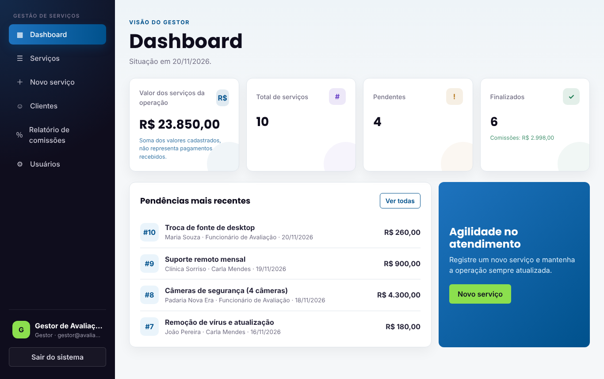
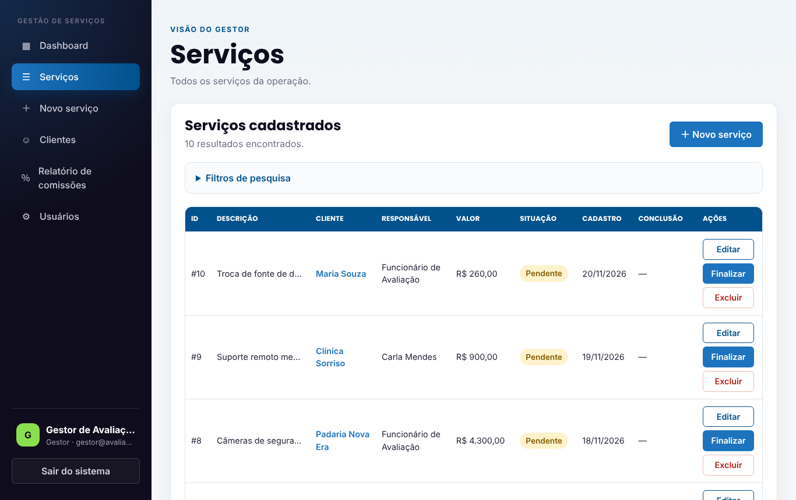
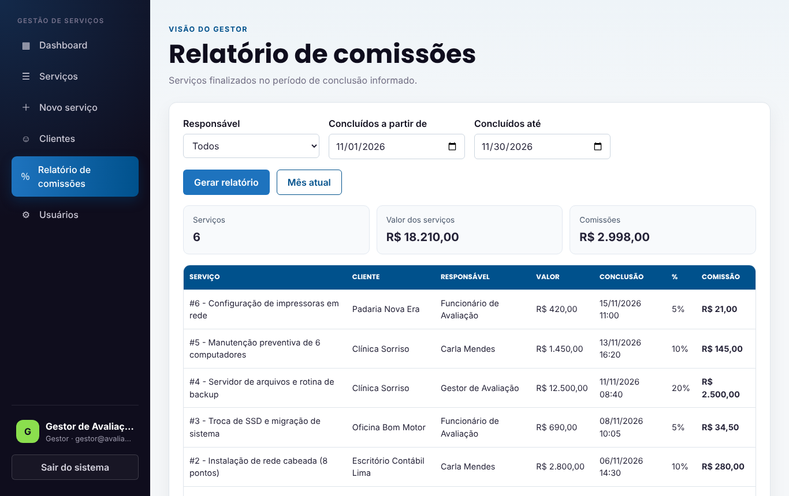

# Sistema Web para Gestão de Serviços e Comissões

Sistema web para pequenas empresas prestadoras de serviço registrarem os atendimentos de cada funcionário e calcularem automaticamente a comissão no momento em que o serviço é finalizado.

Projeto Tecnológico em Desenvolvimento de Sistemas, do curso de Análise e Desenvolvimento de Sistemas da ULBRA. O projeto evolui uma base criada como teste técnico (cadastro de serviços e cálculo de comissão), acrescentando perfis de acesso, clientes, administração de usuários, relatório de comissões e as proteções de integridade definidas no levantamento de requisitos (RF01 a RF15, RNF01 a RNF08).

- **Aplicação publicada:** http://gestaoservicos.free.je (InfinityFree)
- **Acesso para avaliação:** veja [Usuários de avaliação](#usuários-de-avaliação).



## Funcionalidades

| Funcionalidade | Gestor | Funcionário |
|---|---|---|
| Login e saída (sessão renovada, usuário inativo não entra) | ✓ | ✓ |
| Dashboard: total, pendentes, finalizados, valor dos serviços e 5 pendências recentes | Operação geral | Somente os seus |
| Registrar serviço (cliente ativo, descrição, valor) | Escolhe o responsável | Sempre o responsável |
| Editar serviço pendente (descrição, valor, cliente) | Todos; também troca o responsável | Somente os seus |
| Finalizar serviço (registra data, comissão, percentual e quem finalizou) | Todos | Somente os seus |
| Excluir serviço pendente | ✓ | — |
| Pesquisar serviços: descrição, cliente, responsável, situação e período, 25 por página | Todos | Somente os seus |
| Clientes: cadastrar | ✓ | ✓ |
| Clientes: consultar | Ativos e inativos | Ativos (e os inativos dos seus serviços) |
| Clientes: editar e inativar | ✓ | — |
| Usuários: cadastrar, editar perfil e inativar | ✓ | — |
| Relatório de serviços finalizados e comissões, com totais | Todos ou por responsável | Somente os seus |

<p align="center">
  
  
</p>

## Regras de negócio

**Comissão (RF10).** Calculada na finalização, sobre o valor integral do serviço (sem cálculo progressivo), com duas casas decimais:

| Valor do serviço | Percentual | Exemplo |
|---|---:|---|
| Até R$ 1.000,00 | 5% | R$ 800,00 → R$ 40,00 |
| Acima de R$ 1.000,00 até R$ 10.000,00 | 10% | R$ 2.500,00 → R$ 250,00 |
| Acima de R$ 10.000,00 | 20% | R$ 12.000,00 → R$ 2.400,00 |

As faixas são fixas no sistema e iguais para todos os funcionários. O percentual aplicado é gravado junto com a comissão (`commission_rate`), de modo que, se as faixas mudarem no futuro, os serviços já finalizados continuam com o cálculo da época. O cálculo é feito em centavos inteiros para evitar erros de arredondamento de ponto flutuante.

**Situação do serviço.** Não existe coluna de situação: o serviço é *pendente* enquanto `finished_at` está vazio e *finalizado* quando a data é registrada.

**Serviço finalizado não muda (RF11).** Depois da finalização o serviço não pode ser editado nem excluído. A finalização roda em uma transação que bloqueia o registro (`SELECT ... FOR UPDATE`): se alguém estiver editando o valor ao mesmo tempo, a finalização espera e calcula a comissão sobre o valor final.

**Inativar em vez de apagar.** Usuários e clientes são inativados, nunca excluídos. Os serviços anteriores continuam vinculados a eles. Um cliente inativo não pode ser escolhido para novos serviços, e o último gestor ativo não pode ser inativado nem perder o perfil de gestor.

**Cancelamento e estorno.** Não fazem parte desta versão (não estão entre os requisitos). A evolução prevista é registrar um lançamento de estorno ligado ao serviço finalizado, preservando o histórico em vez de alterá-lo.

## Tecnologias

- PHP 8.1 ou superior, orientado a objetos, com arquitetura MVC própria (sem framework, sem Composer)
- MySQL 8.0.16 ou superior (ou MariaDB 10.5+) com PDO e consultas preparadas
- HTML, CSS e JavaScript sem bibliotecas externas
- Git para versionamento

## Estrutura

```text
projeto/
├── app/
│   ├── Controllers/   recebem a requisição, conferem permissão e chamam modelos e serviços
│   ├── Core/          roteador, autenticação e perfis, CSRF, conexão, mensagens, logs
│   ├── Models/        consultas ao banco (User, Client, Service), com paginação
│   ├── Services/      regras de negócio: comissão, finalização em transação, e-mail
│   └── Views/         telas (layout comum, serviços, clientes, usuários, relatório)
├── config/            database.example.php (modelo da conexão)
├── database/          schema.sql, seed.sql e migration_v2.sql
├── docs/images/       imagens desta documentação
├── public/            index.php (ponto de entrada), .htaccess, CSS e JavaScript
└── storage/logs/      registros técnicos (fora da pasta pública)
```

## Instalação local

### 1. Requisitos

- PHP 8.1+ com as extensões `pdo_mysql` e `mbstring` (confira com `php -m`)
- MySQL 8.0.16+ ou MariaDB 10.5+ em execução

### 2. Banco de dados

Crie um banco vazio e importe os scripts, nesta ordem:

```sql
CREATE DATABASE gestao_servicos CHARACTER SET utf8mb4 COLLATE utf8mb4_unicode_ci;
USE gestao_servicos;
SOURCE C:/caminho/do/projeto/database/schema.sql
SOURCE C:/caminho/do/projeto/database/seed.sql
```

- `schema.sql` cria as tabelas `user`, `client` e `service`, com chaves estrangeiras e restrições `CHECK`.
- `seed.sql` cria os usuários de avaliação e dados de exemplo: cinco clientes e sete serviços, três deles finalizados (um em cada faixa de comissão). As datas são relativas ao dia da importação.

No `SOURCE`, use o caminho completo com barras `/` e sem `;` no final. Também é possível abrir os arquivos no MySQL Workbench ou no phpMyAdmin e executá-los.

> **Já tem um banco da versão anterior (tabelas `user` e `service` do teste técnico)?** Faça uma cópia de segurança e execute somente `database/migration_v2.sql`. Ela renomeia as colunas, adiciona o perfil (o primeiro usuário vira gestor), cria a tabela de clientes e vincula os serviços antigos a um cliente genérico inativo.

### 3. Conexão

Copie o modelo e informe os dados do seu MySQL:

```powershell
Copy-Item config/database.example.php config/database.php
```

```php
return [
    'host' => '127.0.0.1',
    'port' => '3306',
    'database' => 'gestao_servicos',
    'charset' => 'utf8mb4',
    'username' => 'root',
    'password' => '',
];
```

O arquivo `config/database.php` está no `.gitignore` e não vai para o repositório.

### 4. Executar

```powershell
php -S 127.0.0.1:8000 -t public public/index.php
```

Acesse `http://127.0.0.1:8000` e entre com um dos usuários abaixo.

## Usuários de avaliação

Criados pelo `seed.sql`:

| Perfil | E-mail | Senha |
|---|---|---|
| Gestor | `gestor@avaliacao.com` | `Gestor@2026` |
| Funcionário | `funcionario@avaliacao.com` | `Funcionario@2026` |

Não existe cadastro público: novos usuários são criados pelo gestor, em **Usuários**.

## Publicação em hospedagem

1. Crie o banco no painel da hospedagem e importe `schema.sql` e `seed.sql` (pelo phpMyAdmin, por exemplo).
2. Envie os arquivos do projeto. O ideal é apontar a raiz do domínio para a pasta `public/`. Se a hospedagem só permitir a pasta `public_html`, envie o **conteúdo** de `public/` para dentro de `public_html` e as pastas `app/`, `config/`, `database/` e `storage/` para o nível acima dela. O `index.php` encontra as outras pastas um nível acima de onde está.
3. Crie `config/database.php` com os dados do banco da hospedagem.
4. Garanta permissão de escrita em `storage/logs/`.
5. Em Apache, o `public/.htaccess` direciona as rotas para o `index.php` e força HTTPS. Em Nginx, use `try_files $uri /index.php?$query_string;`.
6. Ative o certificado HTTPS no painel. Enquanto ele não estiver ativo, comente as duas linhas de HTTPS do `.htaccess`.

## Segurança

- Senhas guardadas somente como hash (`password_hash` / `password_verify`); a sessão é renovada no login e na saída.
- Cookie de sessão `HttpOnly`, `SameSite=Lax` e `Secure` quando a conexão é HTTPS.
- A cada requisição o usuário é conferido no banco: se tiver sido inativado, a sessão é encerrada.
- Permissões verificadas no servidor em todas as rotas, inclusive quando a URL é digitada diretamente.
- Token CSRF em todas as operações que alteram dados.
- Consultas preparadas com PDO (emulação desativada) e escape de todo conteúdo exibido.
- Erros não são mostrados ao usuário: o detalhe técnico vai para `storage/logs/app.log`.

## Testes

Durante o desenvolvimento, a aplicação foi testada com um banco MariaDB, nos dois perfis, por um roteiro automatizado de requisições HTTP (não incluído no repositório). O roteiro cobre login e sessão, permissões por URL direta, faixas de comissão (inclusive os limites de R$ 1.000,00 e R$ 10.000,00), finalização repetida, edição e exclusão de serviço finalizado, cliente inativo, regra do último gestor, datas inválidas, paginação, CSRF e escape de HTML. Também foi testada a finalização simultânea a uma edição e a migração de um banco da versão anterior.

Para conferir a sintaxe dos arquivos PHP:

```powershell
Get-ChildItem -Recurse -Filter *.php | ForEach-Object { php -l $_.FullName }
```

## E-mail de finalização

Ao finalizar um serviço, a aplicação tenta avisar o responsável por e-mail com a função `mail()` do PHP. Se o servidor não tiver envio configurado, a finalização acontece normalmente e a tentativa fica registrada em `storage/logs/mail.log`.

## Autor

Alfredo Candido Mello Neto, [AlfredoMelloDev](https://github.com/AlfredoMelloDev).
